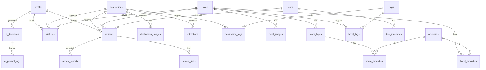

# 🗺️ Phân Tích Source Code — VietTravel AI

## 1. Tổng Quan Dự Án

**VietTravel** là ứng dụng du lịch Việt Nam (Next.js 16 + Supabase), cho phép người dùng khám phá điểm đến, tìm khách sạn, tour và tạo lịch trình thông minh với AI.

---

## 2. Tech Stack

| Layer | Công nghệ | Ghi chú |
|---|---|---|
| Framework | Next.js 16 (App Router, RSC) | `next: 16.1.6` |
| Language | TypeScript strict | `"strict": true` trong tsconfig |
| Styling | Tailwind CSS v4 + shadcn/ui | Radix Nova theme |
| Animation | Framer Motion `^12.38` | Hiệu ứng mượt trên list/page |
| Form | react-hook-form `^7.71` + zod `^4.3` | Kết hợp qua custom hook |
| Backend | Supabase (PostgreSQL + Auth + Storage) | @supabase/ssr |
| Icons | Lucide React `^0.577` | |
| Toast | Sonner `^2.0` | |

---

## 3. Cấu Trúc Thư Mục (thực tế)

```
travel_ai/
├── app/
│   ├── layout.tsx                  # Root layout: Geist font + Toaster
│   ├── error.tsx / loading.tsx / not-found.tsx
│   ├── (client)/                   # Route group có Header + Footer
│   │   ├── page.tsx                # Trang chủ (SSR, fetch featured)
│   │   ├── layout.tsx              # Layout wrap header/footer
│   │   ├── destinations/           # Danh sách + [slug] detail
│   │   ├── hotels/                 # Danh sách + [slug] detail
│   │   ├── tours/                  # Danh sách + [slug] detail
│   │   └── (features)/             # Protected routes (auth required)
│   │       ├── profile/
│   │       ├── itineraries/
│   │       └── my-tours/
│   ├── ai-planner/                 # AI lịch trình (standalone page)
│   ├── auth/                       # Auth callbacks Supabase
│   ├── login/ register/            # Auth pages
│   ├── forgot-password/
│   ├── link-expired/
│   └── reset-password/
│
├── components/
│   ├── ui/                         # 14 shadcn components
│   ├── common/search-input.tsx     # Debounce search input
│   ├── home/                       # 5 sections trang chủ
│   ├── destination/                # List + Detail + actions
│   ├── hotel/                      # List + Detail + actions
│   ├── tour/                       # List + Detail + actions
│   ├── ai-planner/                 # AI Planner form + result
│   ├── features/feature-sidebar.tsx
│   ├── login/ register/
│   └── layout/client/header.tsx + server/footer.tsx
│
├── lib/
│   ├── supabase/
│   │   ├── client.ts               # Browser singleton client
│   │   ├── server.ts               # Cookie-based server client
│   │   ├── proxy.ts                # Middleware auth guard logic
│   │   └── admin.ts                # Service role client
│   ├── constants/common.ts         # NAV_ITEMS, DESTINATION_TYPES, ...
│   ├── schema/auth.ts              # Zod login/register schemas
│   └── utils/
│       ├── common.ts               # formatPrice, timeAgo, getInitials
│       └── server-actions.ts       # createServerAction wrapper
│
├── hooks/
│   ├── use-form-with-server-action.ts
│   └── use-action-result-handlers.ts (+ use-toast-notifications)
│
├── types/
│   ├── database.ts                 # Auto-gen từ Supabase CLI
│   ├── destination.ts / hotel.ts / tour.ts / profile.ts / user.ts
│   └── common.ts                   # ActionResult type
│
├── supabase/migrations/            # 7 migration files
├── proxy.ts                        # Next.js middleware entry
└── styles/globals.css
```

---

## 4. Kiến Trúc & Pattern Chính

### 4.1 Supabase Client Strategy

```
┌──────────────────────────────────────────────────────────┐
│ Client Component  →  lib/supabase/client.ts (singleton)  │
│ Server Component  →  lib/supabase/server.ts (cookies)    │
│ Middleware        →  lib/supabase/proxy.ts               │
│ Admin actions     →  lib/supabase/admin.ts (service role)│
└──────────────────────────────────────────────────────────┘
```

### 4.2 Server Action Pattern

Mọi action đều wrap bởi `createServerAction` → trả về `ServerActionResult<T>`:

```ts
type ServerActionResult<T> =
  | { success: true; data: T }
  | { success: false; error: string }
```

Xử lý đặc biệt: nếu là `NEXT_REDIRECT` hoặc `NEXT_NOT_FOUND` → re-throw (không nuốt lỗi).

### 4.3 Form Pattern (RHF + Server Action)

```
useFormWithServerAction
  ├── useForm (react-hook-form + zodResolver)
  ├── useActionState (React 19)
  └── useActionResultHandler (xử lý success/error callback)
```

FormData được deserialize thủ công: hỗ trợ `File`, `File[]`, `object` (JSON.stringify), `null` (`__NULL__`), primitive.

### 4.4 Middleware Auth Guard

```
proxy.ts (Next.js matcher) → lib/supabase/proxy.ts (updateSession)

Logic:
  1. Refresh Supabase session
  2. Nếu CHƯA đăng nhập + PRIVATE route → redirect /login
  3. Nếu ĐÃ đăng nhập + AUTH page → redirect /
  4. Nếu vào /admin + không phải role=admin → redirect /
```

**AUTH_PATHS**: `/login`, `/register`, `/forgot-password`, `/link-expired`  
**PUBLIC_PATHS**: `/`, `/tours`, `/destinations`, `/hotels`

---

## 5. Database Schema

### Bảng chính



### Enums

| Enum | Values |
|---|---|
| `destination_type` | beach, mountain, culture, city, countryside, island |
| `user_role` | user, admin |
| `user_status` | active, banned |
| `review_target_type` | destination, hotel, tour |
| `wishlist_target_type` | destination, hotel |
| `report_status` | pending, reviewed, dismissed |

---

## 6. Tính Năng — Trạng Thái

| Tính năng | Trạng thái | Ghi chú |
|---|---|---|
| Trang chủ (Hero + Featured) | ✅ Done | SSR, fetch featured từ Supabase |
| Danh sách + Chi tiết Destinations | ✅ Done | Filter/search, gallery, reviews, attractions |
| Danh sách + Chi tiết Hotels | ✅ Done | Star rating, amenities, room types |
| Danh sách + Chi tiết Tours | ✅ Done | Itinerary mẫu, booking CTA |
| Auth (Login/Register/Signout) | ✅ Done | Middleware guard, Supabase Auth |
| Forgot/Reset Password | ✅ Done | Email flow qua Supabase |
| Header responsive + user dropdown | ✅ Done | Framer Motion nav indicator |
| AI Planner (`/ai-planner`) | ✅ UI Done | Gọi `/api/ai/generate-itinerary` — **cần kiểm tra API route** |
| Wishlist | ❌ Chưa làm | UI button có nhưng logic chưa có |
| Reviews (tạo, like, report) | ❌ Chưa làm | Chỉ hiển thị, không submit được |
| Trang `/itineraries` | ❌ Shell only | Route tồn tại nhưng chưa có nội dung |
| Trang `/profile` | ❌ Shell only | |
| Trang `/my-tours` | ❌ Shell only | |
| Admin dashboard | ❌ Chưa làm | ADMIN_NAV_ITEMS định sẵn trong constants |
| Google OAuth | ❌ Chưa làm | |

---

## 7. Điểm Đáng Chú Ý

### ✅ Điểm mạnh
- **Pattern nhất quán**: `createServerAction` wrapper chuẩn, tách rõ client/server.
- **Type safety**: Tất cả type lấy từ `database.ts` auto-gen, không tự định nghĩa.
- **Middleware auth**: Xử lý đầy đủ case (unauthenticated, re-login, admin guard).
- **UX tốt**: Framer Motion animations, Skeleton loading, debounce search.
- **Slug-based routing**: `/destinations/[slug]` thay vì ID → SEO friendly.

### ⚠️ Cần lưu ý / cải thiện
1. **AI API route**: `ai-planner` gọi `/api/ai/generate-itinerary` — cần kiểm tra route này có tồn tại và có API key AI chưa.
2. **Hardcode count**: `destination-page-client.tsx` dòng 97 hardcode `{999} điểm đến được tìm thấy` — cần lấy count thực từ action.
3. **Wishlist button**: UI có sẵn ở detail page nhưng `false` hardcode cho trạng thái — chưa connect logic.
4. **Heart icon**: Tương tự wishlist — state `false` hardcode.
5. **Error message cuối `server-actions.ts`**: Default error là tiếng Nhật `'エラーが発生しました。'` — nên đổi sang tiếng Việt.
6. **`(features)` routes**: Profile, itineraries, my-tours là shell rỗng — cần implement.
7. **Admin**: Constants `ADMIN_NAV_ITEMS` đã có cấu trúc đầy đủ, nhưng dashboard chưa build.

---

## 8. Conventions Dự Án

| Loại | Convention |
|---|---|
| Component name | PascalCase |
| File name | kebab-case |
| DB table | snake_case |
| Giá tiền | VNĐ, `formatPrice()` → `toLocaleString('vi-VN')` |
| Rating | NUMERIC(2,1), 1–5 sao |
| Ảnh | URL từ Unsplash hoặc Supabase Storage |
| Thời gian | `timeAgo()` cho relative time |
| Actions | Đặt trong `components/[feature]/actions/` |
| RLS | Tất cả bảng bật RLS; public content SELECT cho all |
| Import type | Từ `@/types/*`, không tự define từ DB |

---

## 9. Migrations Timeline

| File | Nội dung |
|---|---|
| `20260321...remove_guest_role.sql` | Xóa guest role khỏi enum |
| `20260321...add_is_admin_function.sql` | Function `is_admin()` |
| `20260328...update_profile_and_role_enum.sql` | Cập nhật profile, role |
| `20260328...add_tour_system_tables.sql` | Tour + tour_itineraries + reviews + wishlists + amenities |
| `20260329...add_hotel_system.sql` | Hotels + rooms + hotel_amenities + tags |
| `20260329...add_ai_itinerary_schema.sql` | ai_itineraries + ai_prompt_logs |
| `20260329...insert_scrape_data.sql` | Seed data (31KB — destinations, tours, hotels) |
